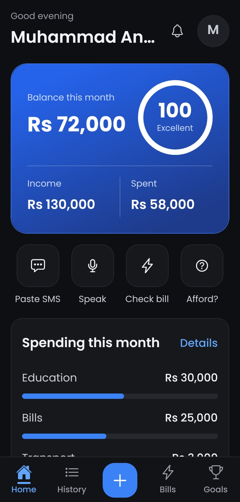
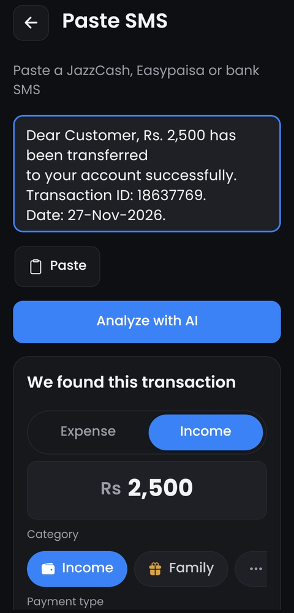
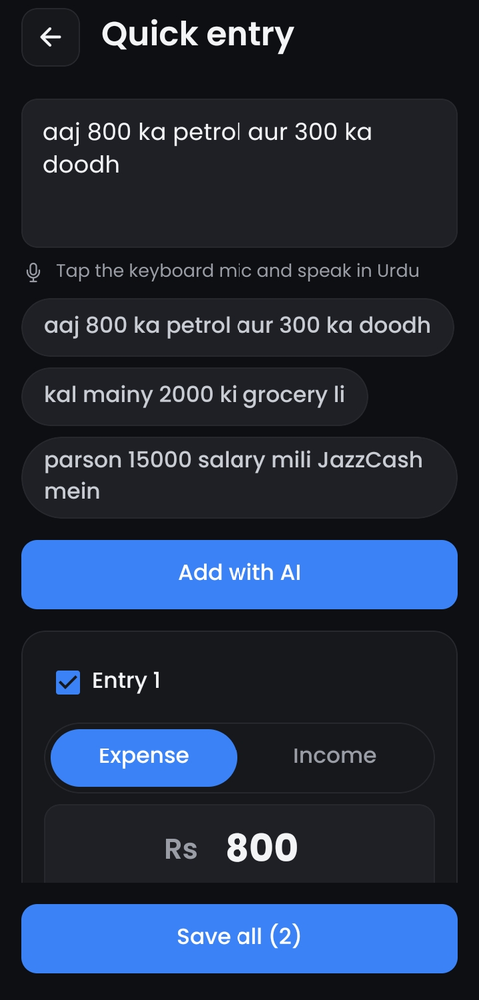
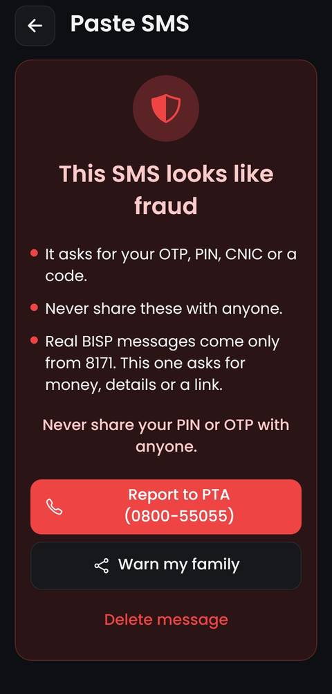
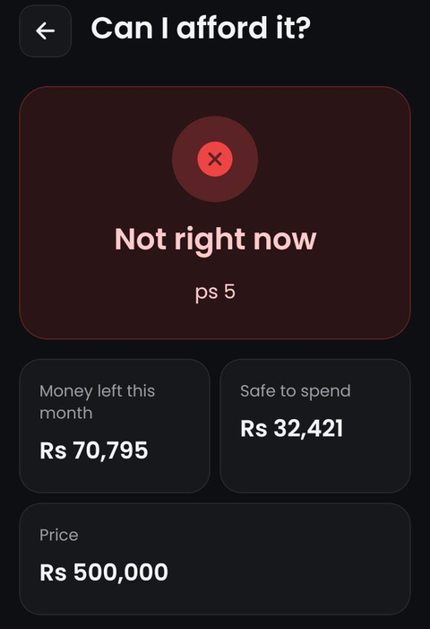
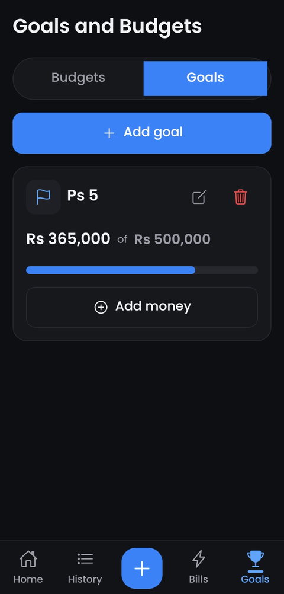
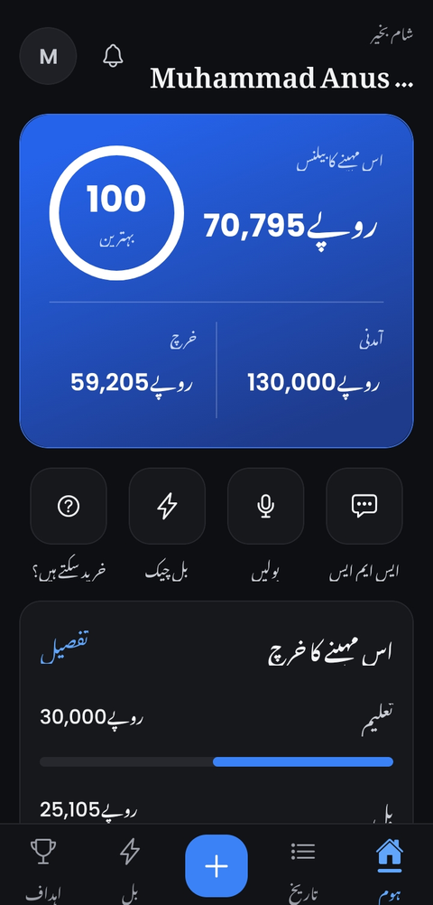

# HisaabKitaab AI

**Hisaab bhi, hifazat bhi** (Accounts and protection, together)

An Urdu-first Android app that helps Pakistani households track money, check electricity bills, and stay safe from scam SMS, using AI for the words and plain rules for every number.

Built by Team Hawk AI for Capital Youth Expo 2026, category FinTech and Financial Inclusion.

## Links

| What | Link |
| --- | --- |
| Source code | https://github.com/HashirShahzad-08/hisaabkitaab-ai |
| Download page | https://hashirshahzad-08.github.io/hisaabkitaab-ai/ |
| Android APK download | https://github.com/HashirShahzad-08/hisaabkitaab-ai/releases/latest/download/hisaabkitaab-ai.apk |
| Backend health check | https://hisaabkitaab-ai-omega.vercel.app/health |
| Demo video (2 min) | https://drive.google.com/file/d/1ZPI2ahpoFSIYd0cVRVECu7sQwg0xVE6F/view?usp=sharing |
| Slides | https://github.com/HashirShahzad-08/hisaabkitaab-ai/blob/main/docs/HisaabKitaab-AI-Pitch-Deck.pdf |

## The problem

Many Pakistani households run on notebooks, memory and trust. Common pain points:

- Money is gone by the 20th of the month and nobody knows where it went.
- Electricity bills are hard to read. Billed units can be higher than the meter shows, and most people do not check.
- Fake SMS pretending to be BISP, JazzCash, Easypaisa or a bank ask for a fee, an OTP or a CNIC number. Real people lose real money.
- Most finance apps are in English and need a lot of typing. Many users are more comfortable in Urdu, and in speaking than typing.

**Meet Shazia, 42, Rawalpindi.** She runs a household on a lower-middle income. She keeps accounts in a notebook, gets bills and SMS she cannot always judge, and has family members who also receive scam messages. HisaabKitaab AI is built for her: Urdu screens, short sentences, large buttons, and warnings she can forward to her family in one tap.

## What it does

- **SMS auto-entry with scam warning.** Paste a JazzCash, Easypaisa or bank SMS. The app fills in the transaction (amount, type, category, payment method, date). If the SMS looks like a scam, a red alert explains why.
- **Warn my family.** On a scam alert, one button opens the phone's share sheet with a short warning in the app language (English or Urdu), based on what the SMS asked for. It also gives the PTA number 0800-55055.
- **Offline scam check.** If the server cannot be reached, the phone runs its own copy of the scam rules. With 2 or more red flags it shows the same alert, marked "Checked on your phone (offline)". It never guesses a transaction offline.
- **Urdu quick entry (type or speak).** Write or dictate with the keyboard microphone, for example "aaj 800 ka petrol aur 300 ka doodh", and get one editable entry per item.
- **Bill Analyzer.** Enter the electricity bill readings and amount. Rules check the meter against the billed units, sudden jumps, and the 200-unit level. The AI then explains the result in simple words, gives tips, and writes a ready complaint if the bill is likely overbilled.
- **Can I afford it?** Enter an item and its price. Rules use income, spending so far, days left and the daily average to answer yes, careful or not now, with how many weeks it would take to save.
- **Health Score.** A 0 to 100 score for the month with a short tip (formula below).
- **Goals and Budgets.** Monthly budgets per category with progress bars and warnings. Savings goals with a target date and a weekly saving suggestion.
- **Full Urdu with right-to-left layout.** Every screen works in English and in Urdu script, with the layout mirrored. The language can be switched in Settings.
- **Read aloud.** Optional speaker button that reads tips and explanations aloud (can be turned off in Settings).
- **Demo data.** Settings, About, "Load demo data" fills the account with a sample month for a family in Rawalpindi.

### Health Score formula

Start at 50 points, then:

| Rule | Points |
| --- | --- |
| Saved more than 10% of income this month | +20 |
| Has at least one budget and every budget is within its limit | +15 |
| Spending is below income | +15 |
| Any budget is over 100% used | -20 |

If spending is more than income, the score is capped at 45. The result is kept between 0 and 100. Bands: 80 to 100 excellent, 60 to 79 good, 40 to 59 okay, below 40 care.

## Screenshots

| Home | Paste SMS | Quick entry | Scam alert |
| --- | --- | --- | --- |
|  |  |  |  |

| Can I afford it? | Goals | Urdu mode |
| --- | --- | --- |
|  |  |  |

## How it works

```
Android app (Expo / React Native)
   |  sign in                       |  HTTPS + Firebase ID token
   v                                v
Firebase Auth                  FastAPI backend (Vercel)
Cloud Firestore  <-- app        |  rules first, then AI for words only
reads and writes the           v
user's own data          Groq (primary): openai/gpt-oss-120b
                         Z.ai (fallback): glm-4.5-flash
```

The app saves each user's transactions, bills, budgets and goals directly in their own space in Cloud Firestore. The backend only does the AI work (parse SMS, parse quick entry, analyze a bill, answer "can I afford it") and keeps no user data.

### The "AI + rules" design

Money and safety should not depend on an AI guess, so the AI and plain code check each other.

- **SMS and quick entry:** the AI reads the text first. Then code (`backend/rules.py`) re-checks the parts code does better: amounts, dates (aaj, kal, parson and written dates), payment method, income or expense, category keywords, and scam red flags. Where they disagree, the rules win (unless they may have read an amount only partly, or a scam sign is weak on its own), and the answer's confidence drops from high to medium or low. The app shows a note when confidence is low.
- **Bill Analyzer and Can I afford it:** rules compute every number and the verdict (`bill_rules.py`, `afford_rules.py`). The AI only writes the explanation, tips and complaint. If its text contains any number the rules did not produce, that text is thrown away and a safe template is used. So the AI cannot change a number.
- **Scam fast path:** if the rules find 2 or more independent red flags (for example "pay a fee" and "send your OTP"), the backend answers "scam" immediately with no AI call. It is instant and uses no AI quota.
- **Safety net:** if the AI is down but the rules see a scam, the user is still warned. If the whole server is down, the app's offline check does the same on the phone.
- **Two AI providers:** Groq is tried first (with one retry). If it fails, Z.ai is used (if a key is set).

Scam red flags checked: asks for a fee before receiving money, asks for OTP, PIN, CNIC or password, BISP messages (real BISP messages come only from 8171), prize or lottery or inaam, "sent by mistake, send it back", account block threats with a link, suspicious links (link shorteners, risky endings, look-alike names), fake courier or parcel messages, and job or visa offers that ask for money. English and Roman Urdu keywords are supported.

## Security

- **Login required.** Every AI route checks a Firebase ID token (`Authorization: Bearer ...`). The token is verified with Google's public keys. A missing or invalid token gets HTTP 401.
- **Rate limits.** 8 AI requests per minute and 20 per day for each user, and 150 AI calls per day for all users together. Too many requests get HTTP 429. The counts are kept in memory per server instance, so each instance counts on its own and starts again when it restarts.
- **Input checks.** Dates must be real, text cannot be blank, and numbers must be finite and in range. The user's message is sent to the AI as marked data, not as instructions.
- **Keys stay on the server.** The Groq and Z.ai keys are only server environment variables. The app never contains an AI key. The Firebase values in the app are public identifiers, not secrets.
- **Per-user data rules.** Data lives under `users/{uid}/...` in Firestore. The security rules in `firestore.rules` let a signed-in user read and write only their own data and deny everything else.
- **No keys in the repo.** `.env` files are git-ignored (only `.env.example` files are committed). GitHub secret scanning and push protection are on.
- **Production hardening.** Production is the default (only `ENV=development` turns it off). In production the API documentation pages are off, CORS is limited to listed websites (the Android app does not need CORS), and logs never contain SMS text, bill details or tokens.
- **Startup checks.** The server refuses to start if a required key is missing or is placeholder text.

## Accuracy

These are the results of our rule tests. No AI is used in them, so anyone can repeat them with no key and no network.

| Test | Result | What it covers | How to run |
| --- | --- | --- | --- |
| Scam rules | 79/79 | 30 main, 20 hold-out and 29 trick SMS cases | `python tests/check_rules.py` (in `backend`) |
| Offline scam check on the phone | 103/103 | Sample messages, the red-flag examples, and the same 79 SMS cases | `node utils/offlineScam.test.mjs` (in `mobile`) |
| Bill Analyzer rules | 20/20 | Bill cases and edge cases | `python tests/check_bill_rules.py` |
| Can I afford it rules | 15/15 | Spending cases and edge cases | `python tests/check_afford_rules.py` |

**Honest note:** these are rule tests, not a field accuracy figure: our team wrote the cases and tuned the rules on them (including the hold-out set), so real messages will be harder.

The full AI and rules pipeline can be measured with `backend/tests/run_eval.py` (it uses AI quota). We do not report a figure for it here.

## Try it

1. Download and install the APK from the [download page](https://hashirshahzad-08.github.io/hisaabkitaab-ai/) (allow install from unknown sources if Android asks).
2. Open the app, choose a language, and sign up with an email and password.
3. Go to Settings, scroll to About, and tap "Load demo data". Confirm. Home now shows a sample month for a household in Rawalpindi.
4. Try Paste SMS with a scam message, for example: `BISP: Mubarak ho! Aap ka 25,000 inaam nikla hai. Claim karne ke liye processing fee Rs 500 jama karwayein: http://bit.ly/bisp-claim`. Then tap "Warn my family".
5. Turn on airplane mode and paste the same SMS to see the offline check.
6. Open Bills to see the saved overbilled electricity bill, or check a new one.
7. Switch to Urdu in Settings to see the right-to-left layout.

## Run locally

### Backend (Python 3.12)

```bash
cd backend
python3.12 -m venv .venv
# Windows:   .venv\Scripts\activate
# Mac/Linux: source .venv/bin/activate
pip install -r requirements.txt
cp .env.example .env        # Windows: copy .env.example .env
# edit .env: set GROQ_API_KEY and FIREBASE_PROJECT_ID (ZAI_API_KEY is optional)
uvicorn main:app --reload
```

The server runs at http://127.0.0.1:8000 and the health check is at `/health`. In development the API docs are at `/docs`.

Plain-rule tests (no AI, no network): `python tests/check_rules.py`, `python tests/check_bill_rules.py`, `python tests/check_afford_rules.py`, `python tests/check_text.py` (number formatting, with a fake AI).
AI accuracy test (uses real AI quota): `python tests/run_eval.py` (options: `--file`, `--only`, `--ids`, `--compare`, `--sleep`, `--provider zai`).

### Mobile app (Node.js and npm)

```bash
cd mobile
npm install
cp .env.example .env
# edit .env: EXPO_PUBLIC_API_URL=http://<your PC IP>:8000   (or the deployed URL)
npx expo start
```

Open the project on an Android phone on the same Wi-Fi (or an Android emulator). To build an APK: `eas build --platform android --profile preview` (the deployed backend URL is set in `mobile/eas.json`).

## External APIs and services

| Service | Used for |
| --- | --- |
| Groq API, model `openai/gpt-oss-120b` | Primary AI: reads SMS and Urdu quick entry, writes bill and affordability explanations |
| Z.ai API, model `glm-4.5-flash` | Backup AI, used only if Groq fails |
| Firebase Authentication | Email and password sign up and login, and the ID tokens the backend checks |
| Cloud Firestore | Stores each user's profile, transactions, bills, budgets and goals |
| Google public keys (`googleapis.com` certificates) | The backend uses them to verify Firebase ID tokens, with no service account file |
| Vercel | Hosts the FastAPI backend |
| Expo EAS Build | Builds the Android APK |

No SMS permission is used. The user pastes a message, so the app never reads the inbox.

## Libraries

### Mobile (`mobile/package.json`)

| Library | Version | Purpose |
| --- | --- | --- |
| expo | ~58.0.26 | App framework and build tooling |
| react | 19.3.0 | UI library |
| react-dom | 19.3.0 | Matches React, needed by Expo's package resolution |
| react-native | 0.88.1 | Native mobile UI |
| expo-router | ~58.0.32 | File-based screens and navigation |
| react-native-paper | ^5.15.5 | Buttons, dialogs, text inputs |
| firebase | ^13.4.0 | Authentication and Firestore |
| i18next | ^27.2.5 | Translation engine |
| react-i18next | ^18.0.3 | Translations in React screens |
| expo-localization | ~58.0.5 | Detects the phone language |
| @expo-google-fonts/poppins | ^0.4.1 | English font |
| @expo-google-fonts/noto-nastaliq-urdu | ^0.4.2 | Urdu font |
| expo-font | ~58.0.12 | Loads fonts |
| @expo/vector-icons | ^15.0.2 | Icons |
| moti | ^0.30.0 | Simple animations |
| react-native-reanimated | 4.7.1 | Animation engine |
| react-native-worklets | 0.13.0 | Animation support |
| react-native-gesture-handler | ~3.3.0 | Touch gestures |
| react-native-gifted-charts | ^1.4.83 | Charts (spending and bill units) |
| react-native-svg | 15.16.0 | Vector graphics, health ring |
| react-native-screens | ~4.30.1 | Native screen containers |
| react-native-safe-area-context | ~5.11.1 | Safe areas on phones with notches |
| @react-native-async-storage/async-storage | 2.2.0 | Saves language and login on the phone |
| @react-native-community/datetimepicker | 9.2.1 | Date picker |
| expo-clipboard | ~58.0.4 | Paste button for SMS |
| expo-speech | ~58.0.4 | Read aloud |
| expo-haptics | ~58.0.8 | Touch feedback |
| expo-linear-gradient | ~58.0.4 | Gradients on the Home balance card and loading placeholders |
| expo-linking | ~58.0.17 | Link handling that Expo Router needs |
| expo-constants | ~58.0.16 | App version info |
| expo-splash-screen | ~58.0.14 | Splash screen |
| expo-status-bar | ~58.0.5 | Status bar style |
| expo-system-ui | ~58.0.7 | Dark system background and native dark controls |
| expo-updates | ~58.0.22 | Restarts the app after a language change (updates are switched off) |

### Backend (`backend/requirements.txt`)

These versions are pinned in `requirements.txt` and were tested with Python 3.12.

| Library | Version | Purpose |
| --- | --- | --- |
| fastapi | 0.165.0 | Web API framework |
| uvicorn[standard] | 0.54.0 | Web server |
| openai | 3.57.0 | Client for the Groq and Z.ai APIs (both are OpenAI-compatible) |
| pydantic | 2.14.4 | Request and answer validation |
| python-dotenv | 1.2.4 | Reads settings from `.env` |
| google-auth | 2.63.1 | Verifies Firebase ID tokens |
| requests | 2.34.2 | HTTP client used by google-auth |

## Team Hawk AI

NUTECH University

| Member | Role |
| --- | --- |
| Muhammad Anus Manan | Team Lead |
| Hashir Shahzad |  AI backend |
| Shaban Faqar | Team member |
| Syed Ruidar Ali Shah | Team member |
| Muhammad Azfar | Team member |

## Built during the hackathon

This project was built during the hackathon window, November 23 to 27, 2026. We used AI coding tools (Claude Code) to help review code, as allowed by the rules. The design, the rules, the test cases and the decisions are ours, and the full history is in the git log.
